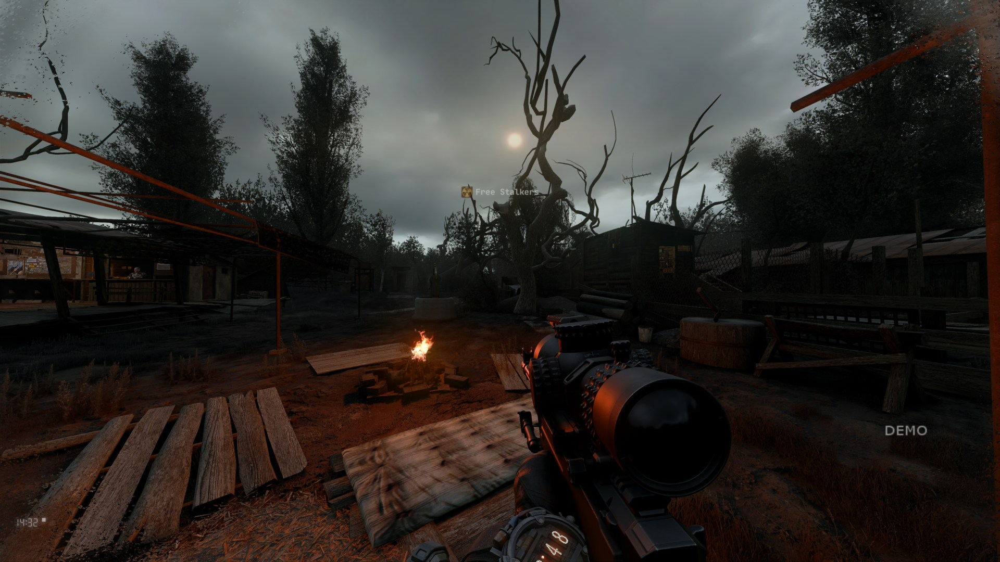
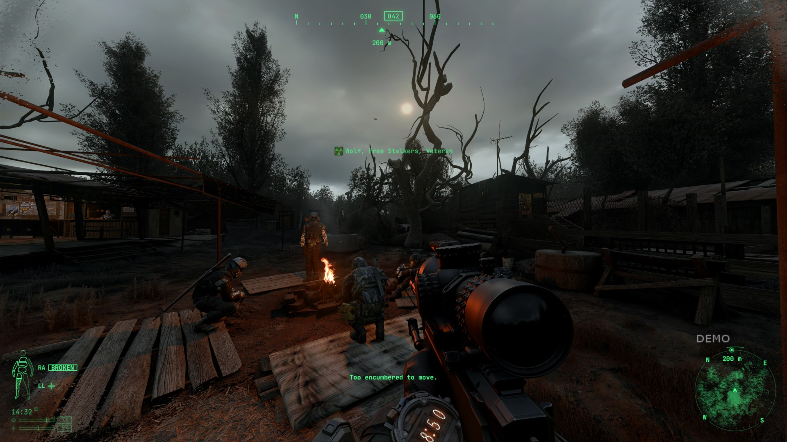
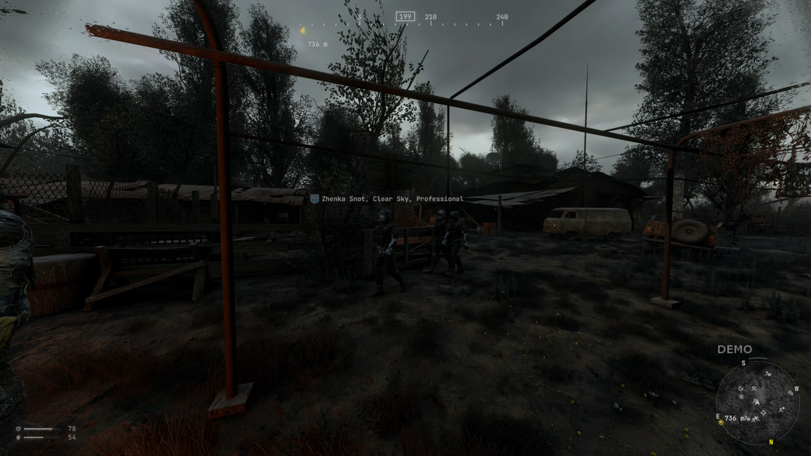
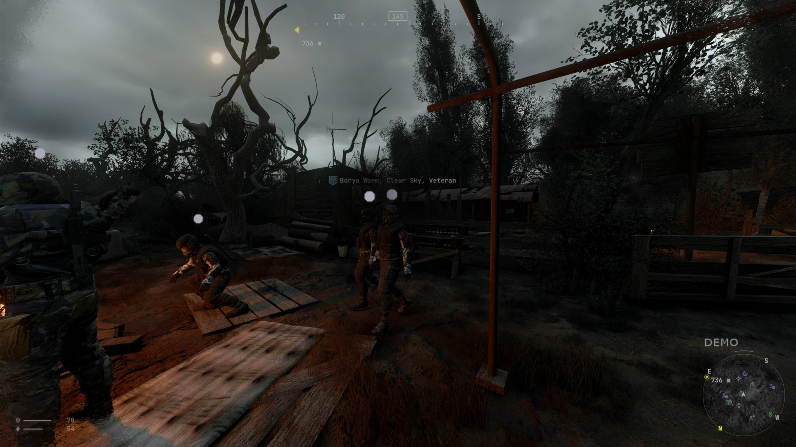
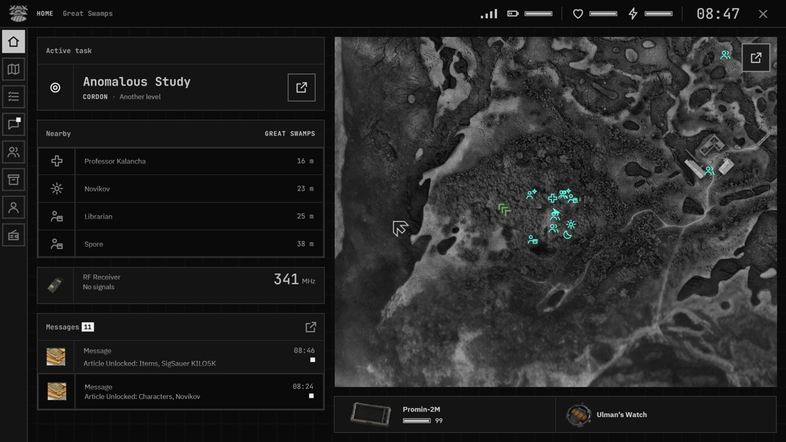
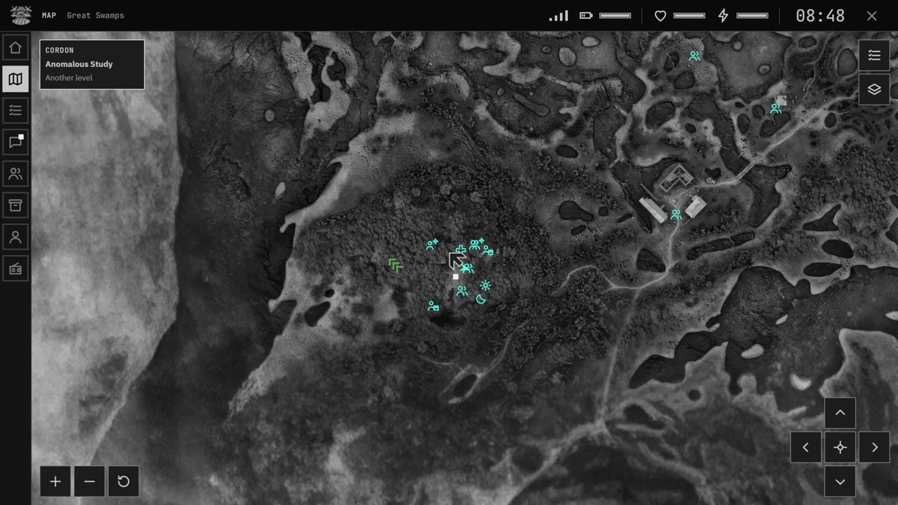
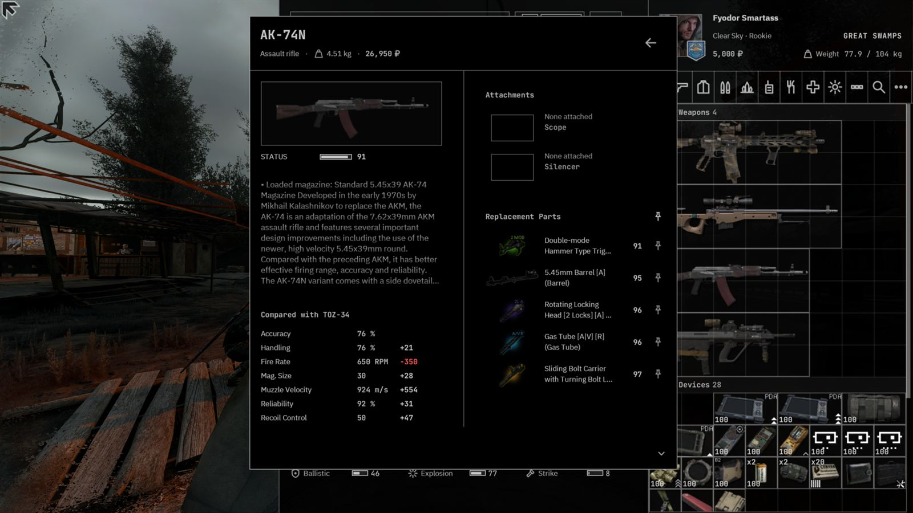
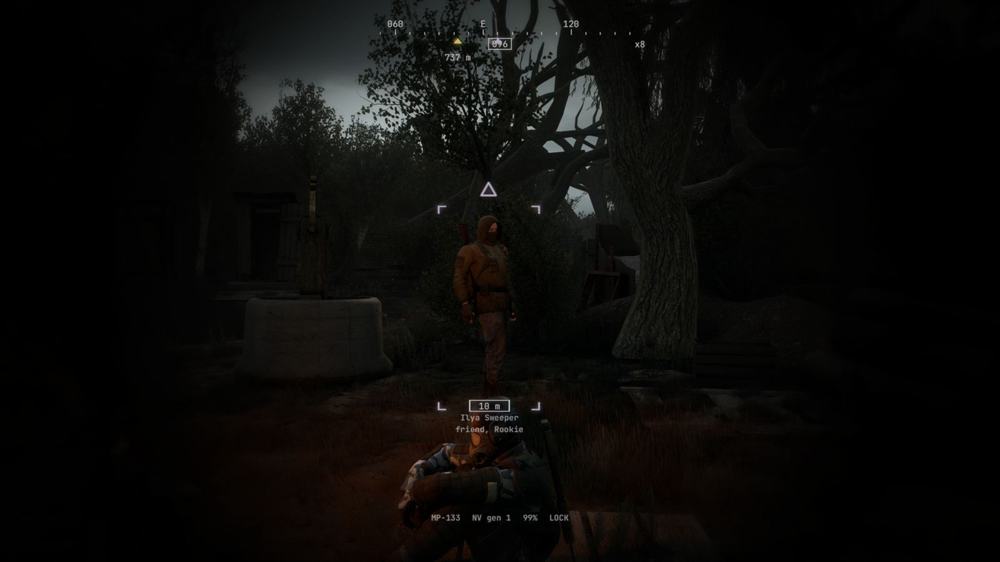
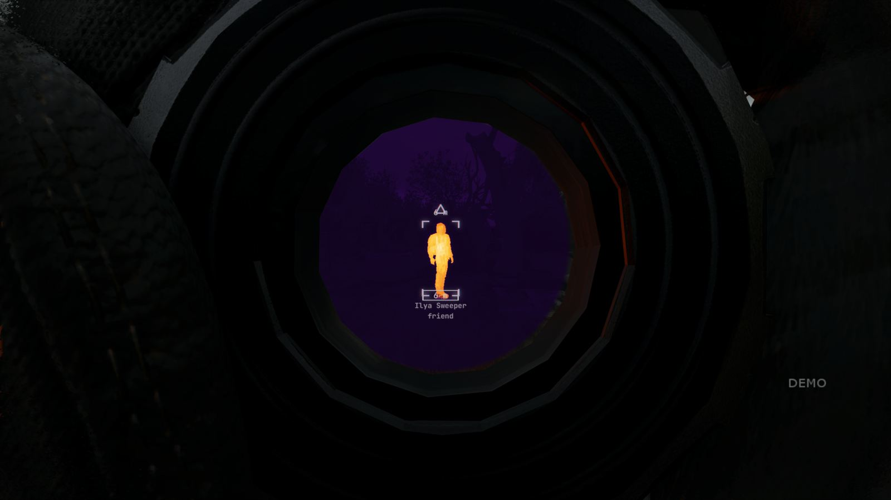
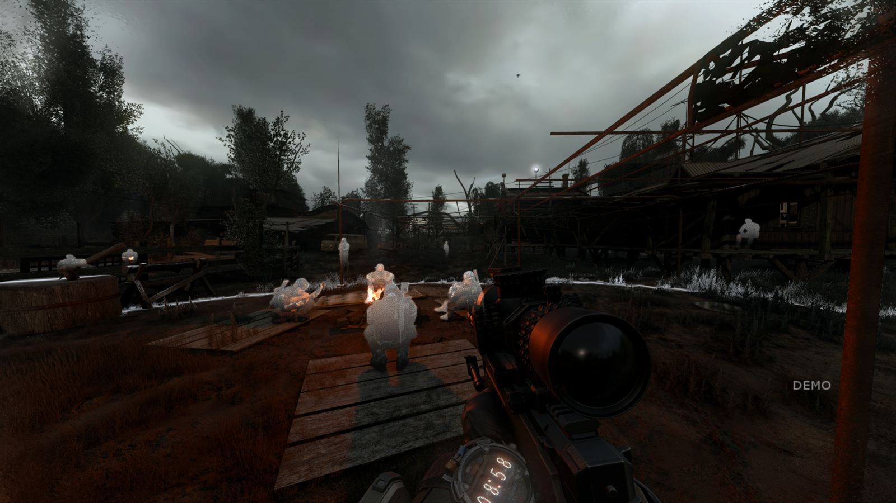

# PDA Redesign

A redesign of the G.A.M.M.A. PDA and the screens around it for S.T.A.L.K.E.R. Anomaly, shipped as one MO2 mod,
`Z_PDA_Redesign`. It carries the PROMIN look of Wearable Devices onto the PDA, adds an AR HUD that follows the visor and
devices you wear, binoculars with thermal and night vision, and restyled inventory, trade, loot and crafting screens.

**Status: public alpha for testing.** Expect rough edges. Report what you find in
[Issues](https://github.com/estebanaraya/pda-redesign/issues): what you did, what you saw, your screen size and renderer,
and the lines starting with `[pdar]` from your game log.

## Screenshots

The full manual, every tier and function in its own layout: **https://estebanaraya.github.io/pda-redesign/**

| | |
|---|---|
|  Gen 1 visor |  Gen 2 visor |
|  Gen 3 visor |  Gen 4 visor |
|  PDA home, Advanced screen |  Map, levels and world |
|  Item details in the inventory |  B2 Yastrub binoculars |
|  KILO5K, heat in the eyepiece |  C-Consciousness wave (shader bus PR 805) |

## Download

Get the zip and the manual from [Releases](https://github.com/estebanaraya/pda-redesign/releases). The `README.md`
inside the zip is the full guide: requirements, install, keys, Wearable Devices, uninstall and known issues.

## Requirements in short

- G.A.M.M.A. (built on installer version 920) with Modded Exes 2026.10.11 or newer.
- Wearable Devices 0.9.2 or later, installed and enabled.
- DX10 or DX11 renderer.
- MarkAlexey's PBR engine build runs the mod (clear the shader cache when you switch engines). Some effects (thermal heat
  through walls, the C-Consciousness wave's bodies, the HUD light effects) need the shader bus from xray-monolith
  [pull request 805](https://github.com/themrdemonized/xray-monolith/pull/805) and fall back without it. No exe ships here.

## Install

In MO2, install a new mod from the zip, enable `Z_PDA_Redesign` and place it at the bottom of the left pane. Existing
saves load. Details are in the README inside the zip.

## Credits

**Work in progress.** This is an initial alpha build, and the credits are still being completed. If your work is
missing or credited wrongly, tell us in [Issues](https://github.com/estebanaraya/pda-redesign/issues).

S.T.A.L.K.E.R. is a trademark of GSC Game World. This is an unofficial, free, non-commercial fan addon. Everything that
comes from another mod or font is credited in [CREDITS.md](CREDITS.md); font licences are in [licenses/](licenses/).
